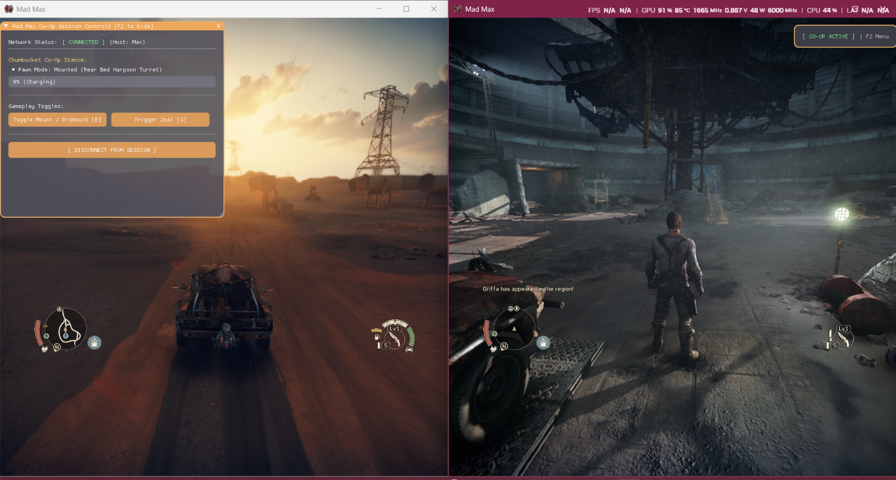
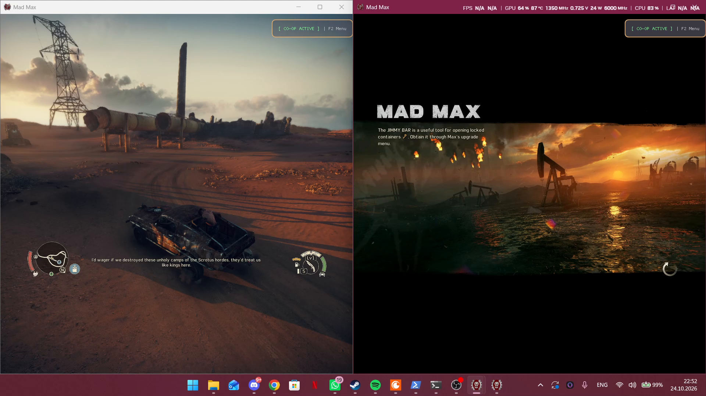

# Mad Max Co-Op Multiplayer Mod – v2

The second version of [madmax-coop](https://github.com/PixallyDev/madmax-coop). It uses the same injected `dxgi.dll` client and UDP relay server, and adds a **host/guest design: Max is the host and the guest plays Chumbucket.** It also adds a smaller in-game HUD and new session controls.

> [!WARNING]
> Experimental prototype. The two game instances share position and state, but Chumbucket isn't a real engine character. The mod drives his stance and actions itself.




## What's new compared with v1

- **Co-op session control panel** (toggle with **F2**): connection status, host/client role, Chumbucket stance
- **Chumbucket modes:** mounted on the rear harpoon turret, or dismounted (**H**, or **E** in older builds)
- **Zeal** ability (**G**) with a charging bar
- **Field scrap repair** (**F**) that shows the car's HP
- **Map and desert sync:** the guest teleports automatically to the host's broadcast position
- Compact `[ CO-OP ACTIVE ] | F2 Menu` HUD badge
- `split_screen.h` helper to place both windows side by side on one PC
- Updated auto scanner and Havok sync

## How it was made

This was forked from v1 at Checkpoint 12. The new work is in `src/client/main.cpp` (UI and gameplay toggles), `havok_sync.h`, `auto_scanner.h`, `remote_render.h` and `split_screen.h`. It uses the same tools as v1: C++20, CMake, MinHook, Dear ImGui (D3D11), ENet and Lua. All of them are vendored in `src/vendor/`. Reverse engineering notes are in `docs/`.

## Building

Requirements: Windows x64, Visual Studio 2022, CMake 3.20+.

```powershell
git clone --recursive https://github.com/PixallyDev/madmax-coop-v2.git
cd madmax-coop-v2
cmake -B build -A x64
cmake --build build --config Release
```

## Running it

1. Put your own Mad Max install (Steam) in `game\`, and a second copy or junction in `game2\` for a two-instance test. Game files aren't included.
2. Copy `build\Release\dxgi.dll` next to each `MadMax.exe`.
3. Start `build\Release\madmax_server.exe` (UDP 7777).
4. Launch instance 1 (host, Max) and instance 2 (guest, Chumbucket).
5. In each window press **F2** and connect to `127.0.0.1:7777`, or the host's IP / VPN IP for online play.
6. Controls for the guest: **H** mount/dismount, **G** Zeal, **F** scrap repair.

For online play, use Radmin VPN or ZeroTier, or forward UDP 7777.

## Related projects

- [madmax-coop](https://github.com/PixallyDev/madmax-coop) – v1
- [multiplayer-mad-max-mod](https://github.com/PixallyDev/multiplayer-mad-max-mod) – clean rewrite with tests
- [splitmadmax](https://github.com/PixallyDev/splitmadmax) – local split-screen

*Fan-made. Not affiliated with Avalanche Studios or Warner Bros.*
